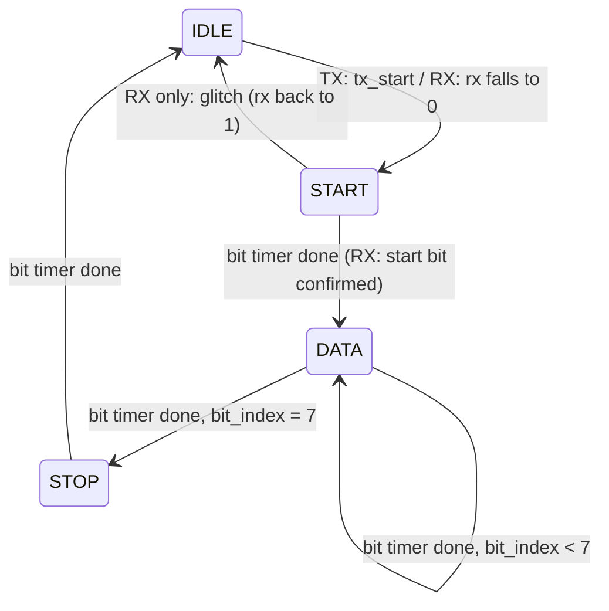

# UART Transceiver in Verilog

A UART transmitter and receiver designed in Verilog and verified with an automated
Python testbench ([cocotb](https://www.cocotb.org/)) running on Icarus Verilog.

**Highlights**
- UART TX and RX built as finite state machines (8 data bits, no parity, 1 stop bit, LSB first)
- Receiver samples in the **center of each bit**, rejects short glitches, and flags framing errors
- **10 automated tests**, including all 256 byte values through a TX→RX loopback
- Receiver verified to tolerate **±3% baud-rate mismatch** between sender and receiver

## How UART works

When nothing is being sent, the line sits at 1. A byte is sent as a 10-bit frame:

```
idle | start | D0 D1 D2 D3 D4 D5 D6 D7 | stop | idle
 1   |   0   |  data bits, LSB first   |  1   |  1
```

Each bit lasts `CLKS_PER_BIT` clock cycles. With a 100 MHz clock at 115200 baud,
that's 100,000,000 / 115,200 ≈ **868 cycles per bit**.

## Design

| Module | Description |
|---|---|
| `rtl/uart_tx.v` | Transmitter. Takes a byte and a `tx_start` pulse, and shifts the frame out on `tx`. `tx_busy` is high while sending. |
| `rtl/uart_rx.v` | Receiver. Detects the start bit, samples each bit at its center, and outputs the byte with a one-cycle `rx_valid` pulse. Raises `frame_error` if the stop bit is wrong. |
| `rtl/uart_loopback.v` | Connects TX directly to RX to verify the two halves work together. |
| `rtl/baud_gen.v` | Standalone baud-rate tick generator (learning step; TX and RX use internal bit timers). |

Both TX and RX use the same four-state FSM:



### Center sampling

The receiver waits **half a bit** after the falling edge of the start bit, then samples
every **full bit** after that, so every bit is read at its center. This gives the most
margin against edge noise and clock mismatch.

Clock mismatch adds up across the frame. The stop bit is sampled about 9.5 bit-times
after the start edge, and the receiver can be off by up to half a bit (434 cycles)
and still read correctly. That allows roughly **±5% mismatch** in theory. The tests
confirm correct reception at ±2% and ±3%.

## Verification

Tests are written in Python with cocotb. Each testbench drives the design's inputs,
watches its outputs, and checks results with assertions.

| Testbench | What it checks |
|---|---|
| `test_uart_tx.py` | Decodes the `tx` line bit by bit and checks the start bit, data bits, and stop bit for several bytes (0x00, 0xFF, 0x55, 0xAA, 0x41) |
| `test_uart_rx.py` | Drives frames onto `rx` and checks the received byte; a bad stop bit raises `frame_error`; a short glitch is ignored; ±2% and ±3% baud mismatch |
| `test_uart_loopback.py` | Sends **all 256 byte values** from TX to RX and checks each one comes back unchanged |
| `test_baud_gen.py`, `test_counter.py` | Timing of the tick generator, and a toolchain sanity check |

**Results: 10 tests, all passing.**


## Running the tests

Requirements: Icarus Verilog, Python 3, cocotb.

```bash
cd tb
make TOP=uart_tx
make TOP=uart_rx
make TOP=uart_loopback
```

View waveforms with GTKWave:

```bash
make TOP=uart_tx WAVES=1
gtkwave sim_build_uart_tx/*.fst
```

## Project structure

```
rtl/    Verilog design files
tb/     cocotb testbenches and Makefile
fpga/   Basys 3 top module and constraints (prepared, not yet tested on hardware)
docs/   Diagrams and waveform screenshots
```

## What I learned

- **Hardware doesn't loop like software.** A UART frame happens in stages (idle, start,
  data, stop), so I built it as a finite state machine where each stage is a state.
- **The FSM decides *what* to do; counters decide *when*.** A bit timer counts 868 clock
  cycles to measure each bit, and a bit index counts 0–7 to track which data bit is
  being sent or received.
- **Sample in the middle of each bit.** The receiver waits half a bit after the start
  bit begins to reach its center, then waits a full bit each time, so every bit is
  read at its center. This gives the most tolerance to noise and clock mismatch.
- **Watch for off-by-one errors.** Counting starts at 0, so 868 cycles means counting
  0 to 867, and testing all 256 byte values needs `range(256)`, not `range(255)`.
- **Verification is half the work.** Writing testbenches that act as a "pretend"
  transmitter or receiver let me check every byte value, framing errors, glitches,
  and baud-rate mismatch automatically.

## Future work

- Run on an FPGA board and talk to a PC over USB-serial
- Add GitHub Actions to run every test automatically on each push
- Add parity support and a receive FIFO